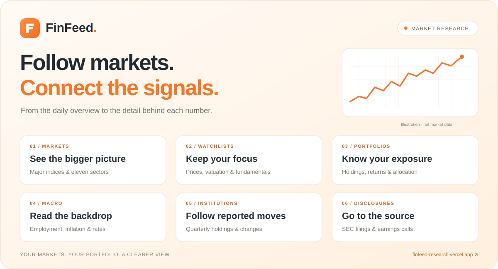

  

  <strong>Your markets. Your portfolio. A clearer view.</strong> 
  A focused workspace for following US markets and connecting prices, company fundamentals, macro trends and institutional activity.

  <a href="https://finfeed-research.vercel.app"><strong>Open FinFeed →</strong></a>

---

## A workspace for the whole research picture

| Follow the market | Understand the company |
| --- | --- |
| **Market overview** — Follow the S&P 500, Nasdaq Composite and Dow Jones, alongside eleven sector ETFs and three-year price charts. Arrange sectors to match your focus. | **Watchlists** — Keep stocks and ETFs together. Compare prices, valuation, quarterly revenue, profitability, net debt, capital spending and free cash flow. |
| **Macro outlook** — Track employment, PCE inflation, the dollar and ten-year Treasury yields. Explore meeting-specific Polymarket expectations alongside their history. | **Company disclosures** — Browse SEC filings and earnings-call entries for your watchlist, filter by company or type, and open original sources. |
| **Institutional holdings** — Explore eighteen institutions across long-term value, technology and growth, quantitative funds and sovereign wealth. Compare reported quarters, new positions, increases, reductions and exits. | **Portfolio tracking** — Track quantities, average costs, market values, unrealized gains and allocation by currency. Keep portfolio records separate from your watchlist. |

## Go from overview to detail

- **Compare at a glance.** Switch between market valuation, quarterly financials and the complete metric table.
- **Inspect the numbers.** Open metric details for reporting periods, source links, calculation inputs and missing-data explanations.
- **Make it yours.** Reorder watched symbols, metric groups and sector cards; save account display preferences across devices.
- **Explore institutional conviction.** View an institution's reported portfolio or search a security to compare changes across tracked institutions.
- **Keep your records portable.** Import and export watchlists and portfolio records.

## Stay informed

Choose email reminders for company disclosures and earnings-call entries, institutional filings, employment and PCE releases, or crossings of your own ten-year Treasury yield threshold.

Previously loaded data stays visible during updates. Reporting periods, retrieval times and stale-data indicators help you see what each snapshot represents.

## Your research workspace

Sign in with a Passkey. Registration is invitation-based. Enabled accounts can share watchlists and portfolios with other signed-in users; editing stays with the record owner.

## Read the context with the number

Market data may be delayed. Quarterly statements and institutional filings describe reporting periods; 13F reports show reportable holdings rather than a complete investment portfolio. Portfolio results cover unrealized gains and losses, and currency totals remain separate. Polymarket prices reflect a contract's market pricing, not an official policy commitment.

<strong>Follow the market. Check the source. Build your own view.</strong>

