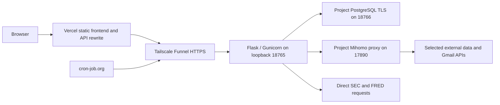

# Architecture and Authentication

Configuration baseline: October 10, 2026, Asia/Shanghai. See [deployment](deployment.md), [server operations](server-deployment.md), [database](database-migration.md), [data and caching](data-and-caching.md), and [email](email-notifications.md).

## Request topology

The server is `47.114.43.129`; all persistent deployment files are beneath `/mnt/data/users/shx/FinFeed`. Database and proxy ports are not public listeners. Funnel exposes the web API only; an HTTPS tunnel does not bypass application authentication.

## Source boundaries

| Module | Responsibility |
| --- | --- |
| `backend/app.py` | Flask factory, authentication, authorization, routes, response security |
| `backend/services/` | Home, sectors, securities, macro, holdings, news, notification workflows |
| `backend/providers/` | Yahoo sessions/history, FRED, BLS, BEA, Alpha Vantage, Polymarket |
| `backend/domain/` | Calculation definitions and account-state validation |
| `backend/storage/` | PostgreSQL transactions, accounts, history, cache, notification state |
| `backend/infrastructure/` | Coalesced refresh jobs, Gmail transport, sanitized failure logging |
| `dashboard/frontend/` | Canonical browser source; `manifest.json` maps public asset names |
| Repository `frontend/` | Vercel copying build, rewrites, login bridge and callback |
| `deployment/worker.py` | Gunicorn initialization without application preloading |
| `deployment/h20/` | Current project supervisor and database/backup launchers |
| `tests/` | Backend and browser-logic regression checks |

The `h20` directory and `FINFEED_H20_ROOT` variable are retained executable names, not the current host. Some provider calls remain in business services; route and storage modules are not fully split into smaller modules.

## Process and concurrency model

The supervisor launches one Gunicorn worker with 64 HTTP threads and a 180-second worker timeout. Database pools are created inside the worker, not inherited from a preloaded parent. The supervisor also owns PostgreSQL, the project proxy, Tailscale, and the daily backup loop.

Refresh jobs have independent lanes: security 4 workers; home, sector, macro, whales, and news 2 each. Total queued/running capacity is 256. Same-key work is coalesced inside a worker; notification source leases provide additional database coordination. Increasing Gunicorn worker count would multiply in-memory lanes, provider sessions, and database pools and therefore requires capacity analysis.

## Passkey and session security

WebAuthn verifies the fixed origin, RP ID, challenge, signature, and user verification. The RP ID remains `finfeed-research.vercel.app`. Challenges expire after five minutes and are consumed once. Device-held private keys never enter the database; public credentials and verification metadata do.

Sessions expire after twelve hours. The dashboard stays hidden and inert until the initial server authentication check succeeds. A non-secret browser expiry hint enables an immediate login redirect for known expired sessions; successful login responses replace that hint and status checks use the remaining server lifetime without extending the session. Missing hints still require server validation. Network failures retain the authentication gate and retry after fifteen seconds. Bearer tokens are hashed in storage. Cookies use Secure, HttpOnly, and SameSite=Strict. Logout invalidates the server session. State-changing requests validate origin, JSON content, and the application's custom request header. Private responses are `no-store`.

The frontend login bridge and callback exchange short-lived authentication tickets between the fixed frontend/backend origins. Preview domains are not automatically authorized. Do not change origin settings to arbitrary incoming Host values; changing a Passkey RP ID can make existing credentials unusable.

## API groups

| API group | Purpose |
| --- | --- |
| `/api/health` | Public process liveness |
| `/api/ready` | Authenticated database and refresh-queue readiness |
| `/api/auth/*` | Registration, login, logout, credentials, frontend ticket exchange |
| `/api/accounts`, `/api/state` | Authenticated directory, shared reads, owner-only updates |
| `/api/invitations`, `/api/admin/*` | Invitations and administrator operations |
| `/api/home`, `/api/home/sectors/<symbol>` | Index and sector snapshots |
| `/api/security/<symbol>` | Shared quote and financial results |
| `/api/macro/<kind>` | Macro indicators and prediction-market data |
| `/api/whales/<kind>` | Institution holdings |
| `/api/news`, `/api/news/<symbol>/<kind>` | Company disclosure indexes |
| `/api/notifications` | Current account subscription and delivery queue status |
| `/api/notifications/email`, `/api/notifications/verify` | Email verification and unbinding |
| `/api/notifications/tick` | Scheduler-token protected background trigger |

Unauthenticated account operations return 401. Cross-account writes are rejected. Scheduler credentials authorize only alert triggering, not user login or database access.

## Isolation limits

Project processes do not modify global DNS, routing, firewall, package environments, or unrelated services. Loopback, private files, and separate SQL roles prevent accidental exposure and operational interference; they are not a strong boundary against another root process or a process using the same OS identity. CPU, memory, disk, and network remain shared host resources.
